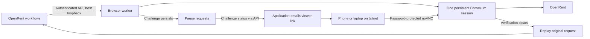

# Browser sessions and human verification

OpenRent's HTTP client can receive an AWS WAF `202 challenge` response instead of
listing HTML. A real Chromium session can execute the JavaScript check; sometimes
it needs a person to complete an interactive challenge. Visiting the site in a
separate browser did not unlock the application's HTTP client on paralimni.

## Design

`OpenRentClient(transport=...)` uses the `FetchTransport` protocol for every
OpenRent document, summary, and image fetch. The protocol defines buffered `get`,
per-attempt pacing, response size limits, cancellation, and close semantics.
`HttpFetchTransport` uses asynchronous HTTPX requests and is the library default.
`BrowserTransport` uses the Chromium worker. `RoutingFetchTransport` chooses
between them using an explicit per-request predicate. Playwright stays inside
the worker container; no runtime methods or library globals are patched.
The client continues to own retries, rate limiting, validation, and parsing.
Concurrency belongs to each transport: `HttpFetchTransport(concurrency=...)`
limits HTTP requests through completion of their response bodies, while Chromium
keeps its single-session lock. `OpenRentClient(concurrency=...)` configures its
default HTTP transport; injected transports own their concurrency configuration.
There is no client-wide slot held while someone completes a CAPTCHA. OpenRent
request pacing stays shared across both transports; other service clients do not
use that limiter.

For example, a caller can compose mixed fetching as follows (assuming `browser`
is an already configured `BrowserTransport`):

```python
from openrent.client import OpenRentClient
from openrent.http_transport import HttpFetchTransport
from openrent.routing_transport import RoutingFetchTransport

transport = RoutingFetchTransport(
    http=HttpFetchTransport(),
    browser=browser,
    use_browser=lambda request: request.url.host == "www.openrent.co.uk",
)
async with OpenRentClient(transport=transport) as client:
    response = await client.search({"term": "London"})
```

That example routes the main site through Chromium and other OpenRent hosts
through HTTP. It illustrates routing, not a guarantee that image hosts accept
HTTP. The router closes both transports and passes the same rate-limit callback
to either one. It does not switch automatically after a challenge or transfer
cookies: HTTP and Chromium keep separate sessions. CLI configuration still
selects HTTP by default or all-browser fetching with `--browser-endpoint`;
mixed routing is a Python composition option. The Compose deployment configures
Chromium for all OpenRent fetching. Map and email service
clients are outside this OpenRent fetch interface.



The browser container runs a small Python API. The first request starts
Chromium, its virtual display, and noVNC. Subsequent requests reuse the **same live
tab and profile**. The user sees that exact tab. The browser, display, and viewer
stop after five idle minutes; the API remains available to start them again.
The container itself is not repeatedly created or destroyed, and the application
does not receive the Docker socket.

In all-browser mode, application-initiated OpenRent HTML, summary JSON, and photo requests use real
browser navigation, including repeated query parameters and the summary API's
`X-Requested-With` header. This is deliberately not Playwright's separate
`APIRequestContext`, and there is no cookie export back into httpx. Map, review,
and email traffic keep their existing clients.

The worker returns the main document's response bytes, status, and selected
headers. Existing parsers and image validation still determine whether the result
is usable. Browser requests are serialized to protect the shared tab. The existing
application rate limit still applies to requested documents/photos, but Chromium's
own scripts, stylesheets, redirects, and challenge traffic are not individually
rate-limited. Browser downloads are rejected above 25 MiB after buffering; unlike
the HTTP photo path, this is not a streaming network-download limit.

## Waiting and resuming

1. AWS's `x-amzn-waf-action` header or recognized challenge HTML identifies a
   challenge. A missing `PROPERTYIDS` alone does **not** imply a CAPTCHA.
2. Allow 15 seconds for JavaScript verification to finish automatically.
3. If it persists, try the AWS CAPTCHA solver once, with a maximum 30-second
   budget inside the request deadline. Gemini selects the puzzle images through
   OpenRouter; the worker redeems AWS's voucher in the existing browser context.
   Reload the requested document and check that verification actually cleared.
4. If solving fails or the document is still blocked, return `423` with an episode identifier. Keep the browser open,
   exempt it from idle shutdown, and stop new navigations.
5. The application logs the viewer link and emails the configured recipients.
   Poll the worker every ten seconds without refreshing the challenge.
6. After the user completes verification and the browser receives a normal
   OpenRent document, replay the original request in that session. Only that
   response goes to the application. Navigating to an unrelated page is not proof
   that the pending request succeeded.

The DBOS step waits asynchronously instead of exhausting three retries on a CAPTCHA.
Other OpenRent browser requests wait behind it; HTTP-routed requests, review,
and digest queues can continue, subject to their own worker/queue capacity.
SIGTERM cancels the wait normally. Existing DBOS recovery rules still apply: a daemon
restart can recover interrupted work with the same application version, but this
does not automatically rewind failures from the previous implementation/version.

The profile volume preserves cookies and local storage across idle shutdown and
container replacement. Session expiry can still require another verification.
A worker crash loses the live page, so the next request reopens the target with the
saved profile. Failed automatic attempts are not repeated by human-wait polling.

The worker composes a `CaptchaSolver` with a separate Gemini image selector.
`vendor/awswaf` packages upstream commit `0b7d9eb673daa50577453926576e0c9274f9dc75`
with its MIT license. Upstream Python handles silent challenges only; the visual
CAPTCHA protocol is an async Python adaptation of its Go implementation. Chromium
supplies the existing silent-challenge token, avoiding upstream's blocking proof
of work and unsupported challenge types. AWS protocol requests use the browser's
request context; property HTML, JSON and photos still use browser navigation.

The selector uses the same `OpenRouterConfig`, asynchronous Agents SDK Responses
client, strict structured output, and disabled tracing as property reviews. It
sends only puzzle images and the target instruction, with no tools. Model output
must contain unique, in-range integer image indices. Logs record episode, model,
token usage and outcome, without cookies, vouchers, credentials or model output.

Alert attempts are reserved on disk beside the application database before calling
Resend. The same episode is not re-emailed after restart, and different episodes
have a one-hour alert cooldown. A different episode still pending after the
cooldown gets its deferred alert. Uncertain delivery is not retried automatically;
the log link remains available. These alerts are separate from property digests
and require `--browser-alert-to`; existing digest recipients are not implicitly
subscribed. Application startup requires an alert recipient and Resend credentials
when selecting browser fetching. The worker only reports challenge status; it has
no notification logic or email credentials. The application configuration module
wires a notifier callback into its browser transport. No password or API token is
put in an email link.

## Deployment

### Automatic solver validation — 26 November 2026

Branch `codex/awswaf-gemini-solver` was tested locally with Chromium and model
traffic routed through an SSH SOCKS tunnel on paralimni. Production was not modified.
The unmodified upstream Python silent solver failed on OpenRent's unsupported
challenge type (`TypeError: 'str' object is not callable`); this is why the worker
uses Chromium's silent token and the async port of upstream's visual CAPTCHA flow.

A real nine-image challenge was solved with `google/gemini-3.8-flash` through
OpenRouter: 9,919 input tokens, 156 output tokens, approximately 13 seconds from
solve start to resumed HTTP 200. No human interaction was needed. After restarting
the local browser, the normal application fetch path returned 10,470 search
candidates, one summary, a property detail response, and a validated 1439×960 WebP
photo (52,432 bytes). This demonstrates one successful solve and session reuse,
not a measured long-term success rate.

Validation: full suite 298 passed / 1 opt-in browser test skipped; the final
solver-focused suite (including an added timeout case) passed 17 tests, and the
real-browser suite passed both tests separately. Ruff, dependency wheel, application
wheel and source distribution checks passed. The source distribution includes the
local dependency. A Docker image build could not run because this development
machine denies Docker daemon access; no image was published from this branch.

### Configuration

The `Dockerfile` and GitHub workflow build and publish **one image** containing the
application and browser dependencies. `compose.yaml` runs that image in
two containers: the application uses the default `schedule.sh` entrypoint; the
browser service overrides it with `python -m openrent.browser_worker` and runs as
UID 1000. Chromium starts only inside the browser service when a request needs it.
The existing manual `chromium-viewer` container and its profile are separate.
Use one worker and one application for each profile; do not mount a Chromium
profile into two live browsers.

Merging into `main` starts the **Publish container** workflow. After it succeeds,
copy `compose.yaml` to the server. Publishing is restricted to `main`. The server
pulls the image as before; it does not need a source checkout or a second build.

On the deployment host, create secrets as the ordinary deployment user (the worker
runs as UID 1000, matching `adamos` on paralimni):

```sh
mkdir -p secrets
chmod 700 secrets
umask 077
# Generate once; keep existing secrets on subsequent deployments.
test -f secrets/browser-api-token || openssl rand -hex 32 > secrets/browser-api-token
test -f secrets/browser-vnc-password || openssl rand -hex 4 > secrets/browser-vnc-password

export BROWSER_TAILNET_IP=100.64.0.3
export OPENRENT_BROWSER_VIEWER_URL='http://paralimniserver.tailnet.spanashis.com:5801/vnc.html?autoconnect=1&resize=remote'
# Multiple alert addresses are whitespace-separated.
export OPENRENT_BROWSER_ALERT_TO='your-address@example.com'
# paralimni currently blocks Chromium's internal user-namespace sandbox.
# On hosts that support it, omit this and keep the default true.
export BROWSER_CHROMIUM_SANDBOX=false
# Export RESEND_TOKEN and OPENROUTER_API_KEY (or OPENROUTER_TOKEN) as usual.
# The same OpenRouter credential is used for property reviews and CAPTCHA solving.
export BROWSER_CAPTCHA_MODEL=google/gemini-3.8-flash

docker compose --env-file /dev/null config --quiet
docker compose --env-file /dev/null pull openrent browser
docker compose --env-file /dev/null up -d --no-build browser openrent
```

For local development, build the shared image with `docker compose --env-file /dev/null build openrent`
before starting both services. The application waits for the worker's authenticated `/status` healthcheck;
checking health does not start Chromium, so an idle worker remains inexpensive.
The existing `RESEND_TOKEN` is passed to the application only. The worker receives
the shared OpenRouter credential, but no email credentials or application database access.

For a local test through another machine's network, set `BROWSER_PROXY` on the
worker to an HTTP or SOCKS proxy, for example `socks5://127.0.0.1:18080` for an SSH
dynamic forwarding tunnel. Chromium routes its page and challenge traffic through
that proxy. Model clients use their own HTTP(S)_PROXY settings; SOCKS proxy testing
also requires the `socksio` package in the test environment.

Worker logs include browser startup and shutdown, challenge episode IDs, and the
request resumed after verification. Application logs record alert acceptance by
the email provider, duplicate suppression, and delivery failures. Worker failures
include bounded, redacted diagnostics; display and viewer errors reach stderr.

To check the deployment afterward:

```sh
docker compose --env-file /dev/null ps
docker compose --env-file /dev/null logs --tail=100 browser openrent
```

When an alert arrives, connect the phone/laptop to the tailnet, open the email's
viewer link, and use the password stored in `secrets/browser-vnc-password`.
Complete the verification in that browser tab and leave it open. The application
automatically replays its pending request. The link will be unavailable after
the browser's idle shutdown until another browser request starts it.

The viewer uses port **5801**, leaving the manual test browser on 5800. It is only
reachable while Chromium is running. The API is published on host loopback port
8091 and requires the separate bearer token. No VNC or Chromium debugging port is
published. The browser container has a 1 GiB RAM cap, no extra swap allocation,
one CPU, 256 MiB shared memory, and bounded logs. Its profile is stored in the
`browser-profile` named volume. Keep that volume and the application's
`*.browser-alert.json` file when migrating.

The browser sandbox is enabled by default. It needs host support for unprivileged
user namespaces and an appropriate Docker seccomp policy; see
[Playwright's Docker guidance](https://playwright.dev/python/docs/docker).
The current paralimni manual test browser could not enable its internal sandbox.
The example above explicitly selects `BROWSER_CHROMIUM_SANDBOX=false` for those
same host restrictions. Docker's isolation remains enabled. On hosts that support
Chromium's internal sandbox, keep the default `true`; the implementation never
silently disables it.

## Validation and rollout

Client policy tests use a fake `FetchTransport`. Browser RPC tests inject an HTTPX
mock transport through the constructor, covering our challenge replay, pacing,
cancellation, and alert suppression rules without replacing client attributes.
Router tests cover selection, forwarding limits, shared pacing, cleanup, and HTTP
progress during a CAPTCHA wait. HTTP adapter tests cover concurrency limits,
capacity release on cancellation, concurrent callback isolation, and bounded decoding;
existing client tests cover retries, redirect validation, and cancellation.
These tests exercise application decisions. The real-browser test is an
integration check of our worker and deployment wiring, including persistent
profile configuration and viewer authentication, rather than a unit test of
Chromium or Playwright internals.

```sh
uv sync --extra browser
uv run --extra browser pytest
uv run --extra browser ruff check src tests
# Requires Playwright Chromium and its OS libraries; uses only mocked pages.
uv run --extra browser playwright install chromium
OPENRENT_BROWSER_TESTS=1 uv run --extra browser pytest tests/test_browser_worker.py
# Inside the browser image (also requires the test dependencies):
OPENRENT_BROWSER_TESTS=1 OPENRENT_DESKTOP_TESTS=1 uv run --extra browser pytest tests/test_browser_worker.py
```

The browser integration test renders a local simulated verification page, verifies
that polling does not navigate away, completes the simulated interaction, checks
JSON and photo requests, lets the browser shut down, and verifies that its cookie
survives the next launch. Desktop mode also tests the noVNC WebSocket and VNC
password authentication.

On 26 November 2026, a local worker and application transport were tested against
OpenRent through an SSH SOCKS tunnel over the tailnet to paralimni. A real challenge
paused fetching and triggered one email, which the recipient confirmed receiving.
The recipient completed verification through noVNC; the pending search resumed
automatically with HTTP 200. Subsequent requests in that session parsed summary
JSON and a property with 25 gallery entries, then downloaded and validated a
1439 × 960 WebP photo. The test script initially skipped summary enrichment and
used an incorrect detail URL; rerunning with the application's enrichment step
completed the remaining checks. An actual OpenRouter model request through the
same tunnel also completed successfully. The production deployment was unchanged.

The same revision passed 281 automated tests, with the desktop integration test
run separately and passing with Chromium and noVNC enabled. This live check covers
the browser handoff and fetching path; it does not run the scheduled DBOS workflow,
property review, or digest delivery end to end.

Implementation entry points:

- `fetch_transport.py`: application-facing transport interface and lifecycle contract.
- `http_transport.py`: asynchronous HTTP implementation, cookies, and bounded reads.
- `routing_transport.py`: explicit per-request selection between HTTP and Chromium.
- `browser_worker.py`: process lifecycle, persistent browser, request serialization,
  challenge detection/waiting, authenticated API.
- `browser_transport.py`: client polling and reconstructed responses, with an
  injected async challenge callback.
- `browser_notifications.py`: viewer-link email delivery and durable alert suppression.
- `browser_config.py`: CLI/environment configuration and composition of the transport
  and notifier.
- `browser_healthcheck.py`: authenticated worker readiness without starting Chromium.
- `browser_protocol.py`: URL validation and explicit WAF signals.
- `client.py` / `daemon.py`: transport composition and ingestion API.
