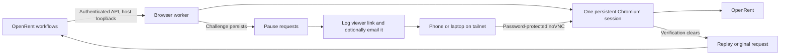

# Browser sessions and human verification

OpenRent's HTTP client can receive an AWS WAF `202 challenge` response instead of
listing HTML. A real Chromium session can execute the JavaScript check; sometimes
it needs a person to complete an interactive challenge. Visiting the site in a
separate browser did not unlock the application's HTTP client on paralimni.

## Design



The optional browser container runs a small Python API. The first request starts
Chromium, its virtual display, and noVNC. Subsequent requests reuse the **same live
tab and profile**. The user sees that exact tab. The browser, display, and viewer
stop after five idle minutes; the API remains available to start them again.
The container itself is not repeatedly created or destroyed, and the application
does not receive the Docker socket.

All application-initiated OpenRent HTML, summary JSON, and photo requests use real
browser navigation, including repeated query parameters and the summary API's
`X-Requested-With` header. This is deliberately not Playwright's separate
`APIRequestContext`, and there is no cookie export back into httpx. Map, review,
and email traffic keep their existing clients.

The worker returns the main document's response bytes, status, and selected
headers. Existing parsers and image validation still determine whether the result
is usable. Browser requests are serialized to protect the shared tab. The existing
application rate limit still applies to requested documents/photos, but Chromium's
own scripts, stylesheets, redirects, and challenge traffic are not individually
rate-limited. Browser downloads are rejected above 25 MiB after buffering; unlike
the HTTP photo path, this is not a streaming network-download limit.

## Waiting and resuming

1. AWS's `x-amzn-waf-action` header or recognized challenge HTML identifies a
   challenge. A missing `PROPERTYIDS` alone does **not** imply a CAPTCHA.
2. Allow 15 seconds for JavaScript verification to finish automatically.
3. If it persists, return `423` with an episode identifier. Keep the browser open,
   exempt it from idle shutdown, and stop new navigations.
4. The application logs the viewer link and optionally emails explicitly configured
   recipients. Poll the worker every ten seconds without refreshing the challenge.
5. After the user completes verification and the browser receives a normal
   OpenRent document, replay the original request in that session. Only that
   response goes to the application. Navigating to an unrelated page is not proof
   that the pending request succeeded.

The DBOS step waits asynchronously instead of exhausting three retries on a CAPTCHA.
Other OpenRent browser requests wait behind it; review and digest queues can continue.
SIGTERM cancels the wait normally. Existing DBOS recovery rules still apply: a daemon
restart can recover interrupted work with the same application version, but this
does not automatically rewind failures from the previous implementation/version.

The profile volume preserves cookies and local storage across idle shutdown and
container replacement. Session expiry can still require another verification.
A worker crash loses the live page, so the next request reopens the target with the
saved profile. There is no automatic CAPTCHA solver.

Alert attempts are reserved on disk beside the application database before calling
Resend. The same episode is not re-emailed after restart, and different episodes
have a one-hour alert cooldown. Uncertain delivery is not retried automatically;
the log link remains available. These alerts are separate from property digests
and require `--browser-alert-to`; existing digest recipients are not implicitly
subscribed. No password or API token is put in an email link.

## Optional deployment

The normal HTTP-only Compose configuration remains the default. This branch adds
`Dockerfile.browser` and `compose.browser.yaml`; neither changes the existing manual
`chromium-viewer` container or shares its profile. Use one worker and one application
for each profile; do not mount a Chromium profile into two live browsers.

On the deployment host, create secrets as the ordinary deployment user (the worker
runs as UID 1000, matching `adamos` on paralimni):

```sh
mkdir -p secrets
chmod 700 secrets
umask 077
openssl rand -hex 32 > secrets/browser-api-token
openssl rand -hex 4 > secrets/browser-vnc-password

export BROWSER_TAILNET_IP=100.64.0.3
export OPENRENT_BROWSER_VIEWER_URL='http://paralimniserver.tailnet.spanashis.com:5801/vnc.html?autoconnect=1&resize=remote'
# Optional; whitespace-separated addresses or repeated --browser-alert-to flags.
export OPENRENT_BROWSER_ALERT_TO='your-address@example.com'
# Export the existing RESEND_TOKEN and review credentials as usual.

docker compose --env-file /dev/null -f compose.yaml -f compose.browser.yaml config --quiet
docker compose --env-file /dev/null -f compose.yaml -f compose.browser.yaml up -d --build
```

The viewer uses port **5801**, leaving the manual test browser on 5800. It is only
reachable while Chromium is running. The API is published on host loopback port
8091 and requires the separate bearer token. No VNC or Chromium debugging port is
published. The browser container has a 1 GiB RAM cap, no extra swap allocation,
one CPU, 256 MiB shared memory, and bounded logs. Its profile is stored in the
`browser-profile` named volume. Keep that volume and the application's
`*.browser-alert.json` file when migrating.

The browser sandbox is enabled by default. It needs host support for unprivileged
user namespaces and an appropriate Docker seccomp policy; see
[Playwright's Docker guidance](https://playwright.dev/python/docs/docker).
The current paralimni manual test browser could not enable its internal sandbox.
For an explicitly isolated test under those same restrictions,
`BROWSER_CHROMIUM_SANDBOX=false` selects the same unsandboxed Chromium mode; it does
not disable Docker's isolation. Resolve that deployment choice before enabling this
for ongoing browsing. The implementation never silently disables the sandbox.

To roll back to HTTP mode, recreate the application using only `compose.yaml` and
stop the browser service. Keep the profile volume. That restores the original
transport, including its susceptibility to the current WAF challenge.

## Validation and rollout

```sh
uv sync --extra browser
uv run --extra browser pytest
uv run --extra browser ruff check src tests
# Requires Playwright Chromium and its OS libraries; uses only mocked pages.
uv run --extra browser playwright install chromium
OPENRENT_BROWSER_TESTS=1 uv run --extra browser pytest tests/test_browser_worker.py
# Inside the browser image (also requires the test dependencies):
OPENRENT_BROWSER_TESTS=1 OPENRENT_DESKTOP_TESTS=1 uv run --extra browser pytest tests/test_browser_worker.py
```

The browser integration test renders a local simulated verification page, verifies
that polling does not navigate away, completes the simulated interaction, checks
JSON and photo requests, lets the browser shut down, and verifies that its cookie
survives the next launch. Desktop mode also tests the noVNC WebSocket and VNC
password authentication. This does not establish that OpenRent will accept an automated
browser in every session. A rollout still needs one real search, one property with
photos, and a phone/laptop verification check before relying on resumed emails.

Implementation entry points:

- `browser_worker.py`: process lifecycle, persistent browser, request serialization,
  challenge detection/waiting, authenticated API.
- `browser_transport.py`: client polling, reconstructed responses, durable alert
  suppression, CLI configuration.
- `browser_protocol.py`: URL validation and explicit WAF signals.
- `client.py` / `daemon.py`: opt-in transport selection and unchanged ingestion API.
